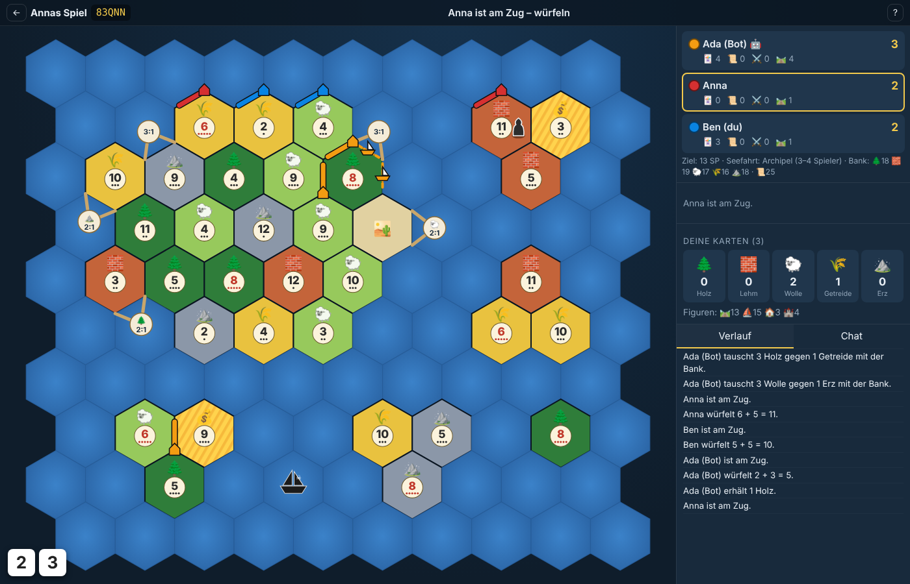

# ⬡ Inselreich

Ein selbst gehostetes **Mehrspieler-Siedlungs- und Handelsspiel auf Hexfeldern**: im Browser, für 2–6 Spieler, mit **Seefahrt-Regeln** (Schiffe, Pirat, Goldflüsse, Inselbonus), Computergegnern und einem **Editor, mit dem man von jeder beliebigen Stellung aus starten kann**.

> Inselreich ist ein freies Hobbyprojekt mit eigenem Namen, eigener Grafik und eigenen Karten. Es ist mit keinem Brettspielverlag verbunden und verwendet weder geschützte Namen noch Originalgrafiken. Die Spielmechanik (Rohstoffe, Würfeln, Bauen, Handeln) ist an bekannte Klassiker des Genres angelehnt.



## Funktionen

- **Echtzeit-Mehrspieler** über WebSockets: Freunde treten per Raum-Code oder Einladungslink bei, ganz ohne Konto
- **2–6 Spieler**, freie Plätze lassen sich mit **🤖 Bots** auffüllen. Auch ein abwesender Spieler kann vorübergehend von einem Bot vertreten werden
- **Alle Grundregeln**: Gründungsphase (Schlangenreihenfolge), Würfeln und Ertrag, Räuber bei 7 mit Abwerfen und Ziehen, Abstandsregel, Straßen, Siedlungen und Städte, Entwicklungskarten (Ritter, Siegpunkt, Straßenbau, Erfindung, Monopol), längste Handelsstraße, größte Rittermacht, begrenzter Bankvorrat
- **Handel**: mit der Bank (4:1), über Häfen (3:1 / 2:1) und mit Mitspielern (Angebot an alle, Annehmen/Ablehnen)
- **Seefahrt-Erweiterung**:
  - Schiffe bauen (Holz und Wolle) und offene Schiffe versetzen (eins pro Zug)
  - Straße und Schiff wechseln nur an einer eigenen Siedlung, auch bei der längsten Handelsstraße
  - Pirat auf dem Meer: blockiert Schiffe und lässt Karten von Schiffsbesitzern ziehen
  - Goldflüsse liefern einen Rohstoff nach Wahl
  - Inselbonus: +2 Siegpunkte für die erste Siedlung auf jeder neuen Insel
- **6 Spielfelder**:

  | Feld | Spieler | Seefahrt |
  |---|---|---|
  | Klassische Insel | 2–4 | – |
  | Große Insel | 5–6 | – |
  | Archipel | 3–4 | ✔ |
  | Zwei Ufer | 3–4 | ✔ |
  | Inselmeer | 5–6 | ✔ |
  | Zufallsinseln (wird jedes Mal neu erzeugt) | 2–6 | ✔ |

- **Von einer bestimmten Stellung starten**:
  - **✏️ Editor** für den Gastgeber: Gebäude, Straßen und Schiffe für jeden Spieler setzen oder entfernen, Räuber und Pirat versetzen, Feldtypen und Zahlen ändern, Rohstoff- und Entwicklungskarten verteilen, Ritter, Bonuspunkte und Siegpunktziel einstellen. Danach legst du mit **„Hier starten“** fest, wer am Zug ist
  - **📋 Stellungscode**: Die aktuelle Stellung wird zu einem kurzen Text (ca. 1 000 Zeichen) oder Link. Man kopiert ihn in den Chat und erstellt daraus mit einem Klick ein neues Spiel, auf dem Server oder in der Offline-Version
  - **💾 Speichern / 📂 Laden**: Der komplette Spielstand ist eine JSON-Datei. Du kannst ihn in einen neuen Raum laden (Startseite) oder in einen laufenden Raum
- **Automatische Speicherung**: Räume und Spiele überstehen einen Server-Neustart. Spieler verbinden sich automatisch neu
- Läuft auf dem **Handy, Tablet und PC**. Chat und Spielverlauf sind eingebaut
- Optionales **Server-Passwort**, damit nur deine Freunde Räume sehen und erstellen können

## Schnellstart

### Mit Docker (empfohlen für den Homeserver)

```bash
git clone https://github.com/linluiben/inselreich.git
cd inselreich
docker compose up -d --build
```

Danach läuft das Spiel auf `http://<IP-deines-Servers>:3000`.

### Ohne Docker (Node.js ≥ 18)

```bash
git clone https://github.com/linluiben/inselreich.git
cd inselreich
npm install
npm start          # → http://localhost:3000
```

Für den Dauerbetrieb kannst du z. B. `pm2 start server/index.js --name inselreich` oder einen systemd-Dienst verwenden (siehe unten).

### Konfiguration (Umgebungsvariablen)

| Variable | Standard | Bedeutung |
|---|---|---|
| `PORT` | `3000` | Port des Webservers |
| `HOST` | `0.0.0.0` | Adresse, auf der gelauscht wird |
| `DATA_DIR` | `./data` | Speicherort der Räume/Spielstände |
| `SERVER_PASSWORD` | *(leer)* | Wenn gesetzt, brauchen alle Spieler dieses Passwort |
| `ROOM_LIST` | `true` | Raumliste mit Spielernamen auf der Startseite zeigen. Im Internet auf `false` setzen |
| `ROOM_TTL_DAYS` | `30` | Inaktive Räume werden nach so vielen Tagen samt Chat gelöscht |
| `MAX_ROOMS` | `50` | Höchstzahl gleichzeitiger Räume |
| `TRUST_PROXY` | `false` | Hinter einem Reverse Proxy auf `true` setzen (echte IP für die Ratenbegrenzung) |
| `ALLOWED_ORIGINS` | *(leer)* | Zusätzlich erlaubte Origins für WebSockets, kommagetrennt |
| `MAX_CONN_PER_IP` | `20` | Gleichzeitige Verbindungen pro IP |
| `BOT_DELAY_MS` | `700` | Pause der Bots zwischen ihren Aktionen |

## Offline-Version ohne Server (GitHub Pages)

Die Spiel-Engine läuft auch komplett im Browser. Das ist ideal zum Ausprobieren gegen Bots oder für eine Runde mit mehreren Leuten **an einem Gerät** (Pass-and-Play mit Übergabe-Bildschirm, damit niemand fremde Karten sieht). Der Spielstand bleibt im Browser gespeichert. Editor, Speichern und Laden funktionieren genauso.

- **Online:** Der Workflow `.github/workflows/pages.yml` veröffentlicht die Version bei jedem Push auf `main` unter **https://linluiben.github.io/inselreich/**. Voraussetzung ist einmalig Settings → Pages → Source: „GitHub Actions“.
- **Lokal:** `npm run build:static` erzeugt `dist/`. Den Ordner kann jeder statische Webserver ausliefern, z. B. `npx serve dist`.

Online mit Freunden geht damit noch **nicht**, dafür braucht es den Server oder später eine P2P-Erweiterung (siehe [Roadmap](docs/ROADMAP.md)).

## Mit anderen spielen

1. Einer erstellt auf der Startseite einen Raum und wird damit **Gastgeber**.
2. Oben im Raum steht der **Raum-Code** (z. B. `K7QXP`). Ein Klick darauf kopiert den **Einladungslink**.
3. Die anderen öffnen den Link oder geben den Code ein, tragen ihren Namen ein und sind drin.
4. Der Gastgeber wählt Spielfeld und Siegpunkte, fügt bei Bedarf Bots hinzu und klickt auf **Spiel starten**.

Wer die Verbindung verliert oder den Browser schließt, kommt über denselben Link automatisch wieder auf seinen Platz. Der Platz ist im Browser gespeichert. Auf einem anderen Gerät tritt man mit **genau demselben Namen** bei und übernimmt so seinen Platz.

### Im Heimnetz (LAN)

Die anderen öffnen einfach `http://<lokale-IP-des-Servers>:3000`, z. B. `http://192.168.1.20:3000`.

### Über das Internet

> 🔒 **Ausführliche Anleitung mit Datenschutz-Abwägung: [docs/ZUGANG-UND-DATENSCHUTZ.md](docs/ZUGANG-UND-DATENSCHUTZ.md).**
> Kurz gesagt: Für eine feste Freundesgruppe nimm **Tailscale**, da musst du keine Ports öffnen. Für Gäste ohne Installation nimm **HTTPS über Caddy** zusammen mit `SERVER_PASSWORD` und `ROOM_LIST=false`.

Es gibt drei Möglichkeiten, von der einfachsten zur „richtigsten“:

- **Tailscale / ZeroTier (am einfachsten und sichersten):** Alle Mitspieler kommen in ein privates VPN und nutzen die Tailscale-IP des Servers. Du musst keine Ports öffnen.
- **Portweiterleitung:** Leite im Router TCP-Port 3000 auf den Homeserver weiter. Mit DynDNS (z. B. DuckDNS) bekommst du eine feste Adresse. Setze dann unbedingt `SERVER_PASSWORD`.
- **Reverse Proxy mit HTTPS (empfohlen bei offenem Zugang):** Wichtig ist, dass WebSockets durchgereicht werden.

**Caddy** (`Caddyfile`, holt automatisch ein HTTPS-Zertifikat):

```
spiel.example.de {
    reverse_proxy localhost:3000
}
```

**nginx:**

```nginx
server {
    server_name spiel.example.de;
    location / {
        proxy_pass http://127.0.0.1:3000;
        proxy_http_version 1.1;
        proxy_set_header Upgrade $http_upgrade;
        proxy_set_header Connection "upgrade";
        proxy_set_header Host $host;
        proxy_read_timeout 1h;
    }
}
```

Das Spiel kann auch in einem Unterpfad laufen (z. B. `https://example.de/inselreich/`). Alle Pfade im Client sind relativ.

### systemd-Dienst (ohne Docker)

```ini
# /etc/systemd/system/inselreich.service
[Unit]
Description=Inselreich
After=network.target

[Service]
WorkingDirectory=/opt/inselreich
ExecStart=/usr/bin/node server/index.js
Environment=PORT=3000
Environment=SERVER_PASSWORD=geheim
Restart=always
User=inselreich

[Install]
WantedBy=multi-user.target
```

## Datenschutz & Sicherheit

- **Keine Konten, Cookies, Tracker oder externen Inhalte:** Der Browser spricht nur mit deinem Server.
- **Gespeichert** werden nur selbst gewählte Spielernamen, Chat und Spielstand. Inaktive Räume werden nach `ROOM_TTL_DAYS` Tagen gelöscht, der Gastgeber kann sie jederzeit selbst löschen. IP-Adressen werden nie auf die Platte geschrieben.
- **Schutzmechanismen:**
  - Server-Passwort, Sperre nach Fehlversuchen, Ratenbegrenzung
  - Origin-Prüfung für WebSockets, strenge Content-Security-Policy
  - strikte Prüfung geladener Spielstände
  - gehärteter Docker-Container

Details und eine Checkliste stehen in [docs/ZUGANG-UND-DATENSCHUTZ.md](docs/ZUGANG-UND-DATENSCHUTZ.md).

## Von einer bestimmten Stellung starten

**Variante A – Editor:**
1. Raum erstellen, Spieler (oder Bots) hinzufügen, **Spiel starten**.
2. Als Gastgeber oben auf **✏️ Editor** klicken.
3. Mit den Werkzeugen die Stellung aufbauen:
   - Siedlung, Stadt, Straße und Schiff für den gewählten Spieler setzen
   - 🗑️ Figuren entfernen
   - Räuber/Pirat versetzen
   - 🗺️ Feldtyp und 🔢 Zahl eines Feldes ändern
   - Karten mit **+ / −** verteilen
4. Spieler auswählen, der am Zug ist (optional „hat schon gewürfelt“), und **▶️ Hier starten** klicken.
5. Mit **💾 Speichern** sicherst du die Stellung, um sie später erneut zu laden.

**Variante B – Stellungscode (am bequemsten zum Teilen):**
- Der Gastgeber klickt im Spiel auf **📋 Code**. Es erscheint ein kurzer Code (`IR1.…`, ca. 700–1 300 Zeichen) mit den Knöpfen **Code kopieren** und **Link kopieren**.
- Den Code fügt man auf der Startseite unter **„Stellungscode einfügen“** ein und klickt auf **Aus Code erstellen**. Mit dem Link geht es noch schneller: Wer ihn öffnet, findet den Code schon vorausgefüllt vor.
- Der Code enthält das Spielbrett, alle Figuren, Handkarten (auch Entwicklungskarten), Bank, Räuber/Pirat und wessen Zug es ist. Weil er alle Handkarten verrät, kann ihn während des Spiels nur der Gastgeber erzeugen.
- Server-Version und Offline-Version verwenden dasselbe Format, die Codes sind also austauschbar.
- Zeilenumbrüche aus Messengern stören nicht.

**Variante C – Datei laden:**
- Auf der Startseite **📂 Spielstand laden** wählen. Es entsteht ein neuer Raum mit genau dieser Stellung. Mitspieler treten mit **demselben Namen** bei, der in der Datei steht, und übernehmen so ihren Platz.
- Oder im laufenden Raum als Gastgeber oben auf 📂 klicken.

Das Dateiformat ist einfaches JSON (Spielbrett, Gebäude, Straßen, Schiffe, Karten, Zugstatus). Man kann es also auch per Hand oder mit einem Skript bearbeiten.

## Eigene Spielfelder

Spielfelder stehen in [`server/maps.js`](server/maps.js) als ASCII-Raster (jede zweite Zeile ist um ein halbes Feld eingerückt):

```
'~ ~ ~ ~ ~ ~',
'~ H L L ~ ~',
'~ L G L L ~',
'~ ~ ~ ~ H ~',
```

Die Zeichen bedeuten:

| Zeichen | Bedeutung |
|---|---|
| `~` | Meer |
| `H` | Meer mit Hafen |
| `L` | zufälliges Land |
| `G` | Goldfluss |
| `D` | Wüste |
| `w` `b` `s` `g` `o` | festes Feld: Holz, Lehm, Wolle, Getreide, Erz |
| `.` | kein Feld |

Mit `seafarers: true` sind Schiffe erlaubt. `islandBonus` legt die Bonuspunkte pro neuer Insel fest.

## Entwicklung

```bash
npm test     # Regeltests + Bots spielen Dutzende komplette Partien auf allen Spielfeldern
```

Aufbau:

- `server/game.js`: komplette Spielregeln. Der Server ist autoritativ, der Zustand ist reines JSON
- `server/maps.js`: Spielfelder, Kartengenerator, Geometrie (Felder, Ecken, Kanten)
- `server/bot.js`: einfacher Computergegner
- `server/index.js`: HTTP- und WebSocket-Server, Räume, Speicherung
- `server/security.js`: Passwort, Ratenbegrenzung, Origin-Prüfung, Sicherheits-Header
- `public/`: Browser-Client (Vanilla JS, SVG-Spielbrett, ohne Build-Schritt)
- `public/local.js` und `scripts/build-static.js`: Offline-Version, bei der der „Server“ im Browser läuft

Geplantes und bekannte Grenzen stehen in der **[Roadmap](docs/ROADMAP.md)**. Rückmeldungen nach einer Runde bitte über den **[Feedback-Bogen](docs/FEEDBACK.md)** bzw. das Issue-Formular „🎲 Feedback“.

## Ähnliche Projekte

Vor dem Start habe ich nach vorhandenen Open-Source-Projekten gesucht:

| Projekt | Was es ist | Seefahrt | Selbst hostbar |
|---|---|---|---|
| [Pioneers](https://www.linuxlinks.com/Pioneers/) | Seit Langem gepflegter Klassiker in C mit GTK-Desktop-Client, Server, KI, Editor und Meta-Server, GPL | ✔ | ✔ (Desktop-Programm, nicht im Browser) |
| [JSettlers2](https://alternativeto.net/software/jsettlers/about) | Java-Client/Server mit Bots, GPL-3.0 | ✔ (neuere Versionen) | ✔ (Java nötig) |
| [OpenSettlers](https://github.com/OpenSettlers/OpenSettlers/wiki) | Webbasierte GWT-Umsetzung, laut eigenem Wiki „quite alpha“ | – | ✔ |
| [gharris1727/Catan](https://github.com/gharris1727/Catan) | Online-Mehrspieler-Umsetzung | – | ✔ |
| [watts4/settlers-catan](https://github.com/watts4/settlers-catan) | React/TypeScript mit Seefahrt, aber nur 1 Mensch gegen 3 KI und auf Firebase | ✔ | – |

**Warum trotzdem ein eigenes Projekt?** Keins davon bietet zusammen alles hier: im Browser ohne Installation, Mehrspieler, Seefahrt, Start aus beliebiger Stellung und ein Docker-Setup für den Homeserver. Pioneers ist die beste Alternative, wenn alle eine Desktop-App installieren mögen.

## Lizenz

MIT, siehe [LICENSE](LICENSE).
